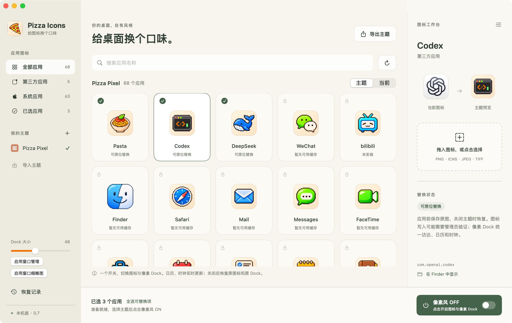
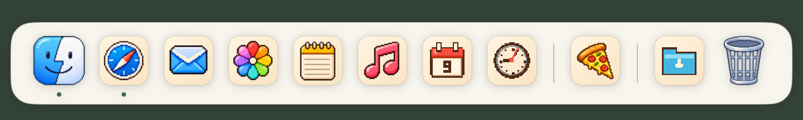

<div align="center">
  

  <h1>Pizza Icons</h1>
  <p><strong>给 Mac 桌面换一套像素图标。</strong><br>
  预览、搭配和切换主题，也可以一起换上像素 Dock。</p>

  <p><kbd>macOS 15+</kbd> &nbsp; <kbd>Apple Silicon</kbd> &nbsp; <kbd>0.7 build 17 · 实验版</kbd></p>
  <p><a href="https://github.com/C0-rrect/Pizza/releases/download/v0.7-build17/Pizza-0.7-build17-macOS-arm64.zip"><strong>下载 Pizza</strong></a> · <a href="#安装">安装</a> · <a href="#使用">使用</a> · <a href="https://github.com/C0-rrect/Pizza/releases/tag/v0.7-build17">版本说明</a></p>
</div>

<p align="center">
  
  <br><sub>图标工作台 · 先比较外观，再应用主题。</sub>
</p>

## 功能

| 功能 | 用法 |
| --- | --- |
| **像素主题** | 内置 68 个应用的像素图标。可以为单个应用导入图片，也可以导入或导出整套主题。 |
| **自定义 Dock** | 固定应用和文件夹、拖动排序，拖住分隔线调整大小。Finder、日历、时钟和废纸篓也有像素图标。 |
| **窗口管理** | 通过 Dock 菜单显示、隐藏或退出应用。授予辅助功能权限后可操作应用窗口；窗口缩略图另需屏幕录制权限。 |
| **恢复原样** | 首次替换时保留原图恢复点，之后切换主题会复用它。关闭主题可恢复原图标和系统 Dock。 |

<p align="center">
  
  <br><sub>像素 Dock · 示例布局，实际应用和顺序可自行调整。</sub>
</p>

## 安装

需要 **Apple Silicon Mac 和 macOS 15 或以上**。此版本在 macOS 15.8.2 上验证。

1. [下载 ZIP 安装包](https://github.com/C0-rrect/Pizza/releases/download/v0.7-build17/Pizza-0.7-build17-macOS-arm64.zip)，解压。
2. 把 **Pizza Icons.app** 拖到「应用程序」，再从 Finder 或启动台打开。
3. 下载包使用本机临时代码签名，未经过 Apple 公证。如果 macOS 阻止启动，可以按下文从源码构建。

[发布页与 SHA-256 校验文件](https://github.com/C0-rrect/Pizza/releases/tag/v0.7-build17)

## 使用

1. **预览主题。** 在左侧选择 `Pizza Pixel`，用「主题 / 当前」对照图标外观，或在右侧导入自己的图标。
2. **开启像素风。** 点击右下角的「像素风」开关，会对当前可替换的应用启用主题，并开启像素 Dock。写入图标时可能出现 macOS 管理员验证。主题启用后，可勾选应用，再点「应用编辑的主题」查看并应用修改。
3. **调整 Dock。** 拖住分隔线上下移动来缩放；右键打开应用菜单，或把应用拖入 Dock 固定。
4. **恢复原样。** 再点一次「像素风」开关。只退出 Pizza 会恢复系统 Dock，应用图标会保留当前主题。

原图恢复点位于 `~/Library/Application Support/Pizza Icons/Backups/Originals`。恢复原图前请保留它。

## 兼容性

> [!NOTE]
> **这是实验版。** 在普通桌面可以看到像素 Dock；三指上滑进入原版调度中心后，像素 Dock 会消失。这个问题尚未解决。

Pizza 保留 SIP，使用 macOS 未公开的图标缓存和窗口接口，系统更新可能影响兼容性。系统 Dock 的隐藏与大小等设置在主题启用期间会临时调整。窗口缩略图只在本机内存中使用。

<details>
<summary><strong>从源码构建与验证</strong></summary>

安装 Apple Command Line Tools 与 Python 3，克隆后运行：

```sh
git clone https://github.com/C0-rrect/Pizza.git
cd Pizza
python3 build.py
```

输出为 `dist/Pizza Icons.app`。运行 `python3 Tests/check_dock.py` 可用模拟偏好设置检查 Dock 设置的恢复和回滚。

图标、商标及参考资料见 [NOTICE.md](NOTICE.md)。

</details>
